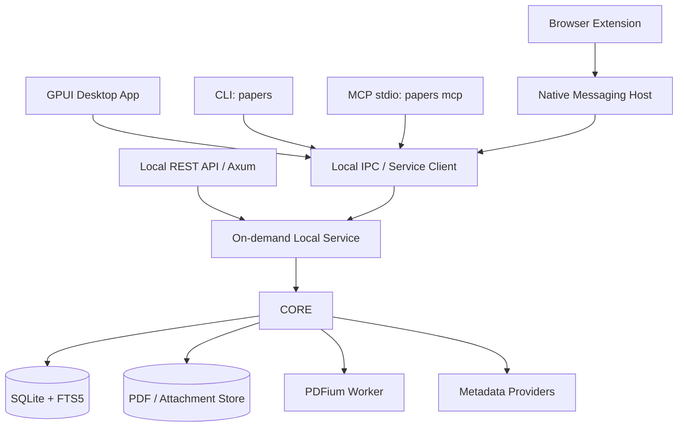
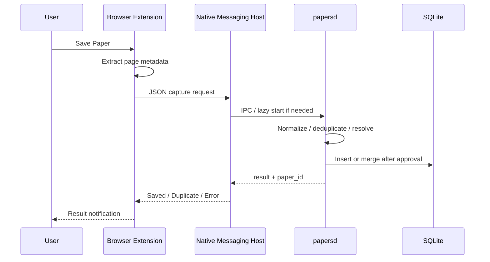

# Rust + GPUI 文献管理アプリ 技術設計書

> **状態:** Draft v0.2（#7 の最小契約・ADR追記）  
> **作成日:** 2026-11-06  
> **製品名:** 未定（本書では *Reference Manager* と呼ぶ）  
> **対象:** macOS ファースト、完全ローカル動作を基本とする Zotero 代替アプリ  
> **想定読者:** 実装者、設計レビュー担当、AI コーディングエージェント

## 1. 概要

Rust と GPUI で、Zotero の主要な文献管理機能を高速・省メモリなネイティブデスクトップアプリとして再構築する。単なる文献一覧ではなく、**論文PDFの閲覧・ハイライト・注釈**、**ブラウザからの保存**、**全文検索**、**Zed 風の Command Palette と Vim キーバインド**、**ローカル API / MCP / CLI を介した AI エージェント連携**までを MVP に含める。

アプリ本体は外部アカウントやサーバーを必要としない。DOI などのメタデータ取得、ブラウザからの文献登録に限りネットワークへアクセスする。Zotero アカウントとの同期は実装しない。

### 1.1 設計原則

1. **Local-first:** 文献メタデータ、PDF、注釈、検索インデックスはすべてローカル保存。
2. **Single source of truth:** GUI、REST API、MCP、CLI、ブラウザ拡張は共通の Rust ドメイン層を利用する。
3. **Low overhead:** レンダリング、全文抽出、インデックス生成は遅延・非同期処理。GPU・画像キャッシュにメモリ上限を設ける。
4. **Keyboard-first:** マウス操作を妨げず、コマンド検索と Vim キーバインドで主要機能に到達できる。
5. **Data portability:** BibTeX/RIS と PDF の入出力を保証し、独自データからの移行・脱出を容易にする。
6. **Citable retrieval:** AI が検索結果を利用するときは、文献識別子とページ番号、引用箇所を追跡できる。
7. **Secure-by-default:** ローカル API でも認証と権限制御を行い、Web ページからの不正な呼び出しを防止する。

## 2. スコープ

### 2.1 MVP に含める機能（P0）

| 分類 | 要件 | 完了条件の概要 |
|---|---|---|
| 文献管理 | 文献一覧、コレクション（フォルダ）、複数所属 | 作成・編集・移動・削除・復元 |
| 整理 | タグ、複合フィルタ、ソート | タグ AND/OR、著者、年、PDF有無など |
| 文献追加 | DOI 登録、手動登録 | DOI からメタデータ取得、重複確認 |
| PDF | 閲覧、複数ページ、ページ移動、ズーム、検索 | ページキャッシュを限定、スクロール可能 |
| PDF 注釈 | テキストハイライト、コメント、注釈一覧 | 永続化、クリックして該当ページへ移動 |
| PDF 搬出 | 注釈付き PDF 書き出し | 元PDFを変更せず別ファイルに出力 |
| 検索 | 文献メタデータ・PDF本文全文検索 | ページ番号付き検索結果、フィルタ連動 |
| 書誌形式 | BibTeX / RIS のインポート・エクスポート | 文字コード・主要項目の往復を検証 |
| ブラウザ連携 | ブラウザから論文ページを保存 | Chrome/Chromium と Firefox、Native Messaging |
| 操作 | Command Palette | `⌘K`、コマンド名・曖昧一致検索 |
| 操作 | Vim キーバインド | 一覧・検索・PDFにおける主要操作 |
| 外部連携 | 認証付きローカル REST API | 一覧・検索・追加・更新・注釈・エクスポート |
| AI 連携 | MCP サーバー | stdio 接続、検索・取得・追加・注釈操作 |
| 自動化 | CLI | GUIなしでも文献の検索・登録・出力可能 |
| 安全性 | バックアップ・DBマイグレーション | データ破損の防止と復旧経路 |

### 2.2 MVP に含めない機能

- Zotero アカウント同期、クラウド同期、共同編集。
- Word / Google Docs へのライブ引用挿入（後続フェーズ）。
- 論文の AI 自動要約・埋め込みベクトル検索（MCP から利用する AI が担当）。
- OCR によるスキャン PDF のテキスト化（当面は抽出可能な文字を対象）。
- PDF 手書き描画、図形、フリーハンド注釈、高度な PDF 編集。
- Zotero Connector / Zotero API の完全互換。
- Safari / Windows 対応（アーキテクチャは拡張可能に設計）。

### 2.3 後続フェーズ（P1/P2）

- **P1:** Word / Google Docs 引用連携、CSL による文献表生成、保存済み高度検索、OCR。
- **P1:** Zotero からの一括移行支援、既存注釈の移行、PDF ファイルの監視・一括整理。
- **P2:** Safari 対応、Linux/Windows 展開、全文・注釈を横断する関連文献推薦、可視化。

## 3. 想定ユーザーフロー

### 3.1 文献を登録して読む

1. ブラウザで論文ページを開く。
2. 拡張機能の「Save Paper」を押す。
3. ページ内 DOI / メタデータを検出し、必要に応じ Crossref 等で補完。
4. PDF が取得可能なら添付し、不可なら文献情報だけ登録する。
5. 重複判定の後、対象コレクションとタグを選択して保存。
6. デスクトップ画面から PDF を開き、ハイライトとコメントを付ける。
7. 文献と注釈がローカル DB に保存され、全文検索対象になる。

### 3.2 論文を AI に調査させる

1. AI クライアントが `papers mcp` を起動する。
2. MCP 経由で `search_papers` を呼び出す。
3. `get_paper_fulltext` / `get_annotations` で該当資料を読む。
4. 結果は文献ID、DOI、PDFページ番号、テキスト抜粋を返す。
5. AI は参照元を明示した比較表・レビューを作成できる。
6. 書き込み系操作は権限設定に従って許可・確認する。

### 3.3 Zotero から移る

- MVP: Zotero から BibTeX/RIS を出力して本アプリへインポート。PDF はファイル/フォルダから取り込む。
- 注釈などが BibTeX/RIS に含まれないことを UI に明示する。
- 将来: Zotero RDF/公式エクスポート形式等による、メタデータと添付ファイル・注釈の高忠実度移行を検討する。
- **Zotero の稼働中の `zotero.sqlite` へ直接書き込まない。**

## 4. 技術スタック

| レイヤー | 第一候補 | 備考 |
|---|---|---|
| デスクトップ UI | Rust + GPUI | Zed 由来の GPU 描画、macOS を優先。API はバージョン固定 |
| UI コンポーネント | GPUI 標準 + 独自コンポーネント | Virtual list、command palette、PDF overlay |
| ドメイン層 | Rust workspace | UI・サーバー・CLI から共通利用 |
| DB | SQLite (`rusqlite` 0.41.1 / bundled) | #7で選択。WAL、外部キー、バージョン付き migration は#8 |
| 全文検索 | SQLite FTS5 | `unicode61` + 必要な領域に `trigram` |
| PDF | PDFium + `pdfium-render` | 表示・テキスト抽出・PDF 注釈出力を検証 |
| API | `axum` + Tokio | 認証付き HTTP/JSON、localhost限定 |
| MCP | `rmcp` | stdio を最優先、HTTP は後から追加可 |
| CLI | `clap` | スクリプト・AI エージェントから利用 |
| メタデータ取得 | `reqwest`, `serde` | Crossref / DataCite 等へのアダプタ |
| ブラウザ拡張 | WebExtensions / TypeScript | Manifest V3、Native Messaging host |
| シリアライズ | JSON + `serde` | API schema 生成を検討 |
| ロギング | `tracing` | 個人情報・PDF本文のログ出力抑制 |
| UUID | UUIDv7（候補） | インポート元の ID と切り離す |
| macOS 配布 | `.app` / `.dmg` | PDFium同梱、コード署名、notarization |

> **技術上の注意:** GPUI は active development の pre-1.0 フレームワークであり、特定リビジョンに固定する。PDFium とその Rust バインディングは ABI / バイナリ配布・ライセンスを検証したうえで採用する。PDFium の並列呼び出しは安全性を確認できるまで専用 worker で直列化する。

## 5. システム構成



### 5.1 プロセスモデル

- **デスクトップアプリ:** GPUI による画面描画と入力処理。重い処理はワーカーに委譲。
- **ローカルサービス `papersd`:** DB更新の単一制御点。GUI、CLI、MCP、ブラウザから同じ操作を受け付ける。
- **MCP `papers mcp`:** stdio の薄いアダプタ。Core のサービスにリクエストを転送する。
- **Native Messaging host:** ブラウザが必要に応じて起動する小さなプロセス。必要なら `papersd` を遅延起動する。
- **HTTP API:** 既定では無効。ユーザーが「ローカルAPIを有効化」を選択したときだけ `127.0.0.1` のランダム/設定済みポートで待ち受ける。
- **サービスの寿命:** CLI/MCP/拡張の要求に応じて起動し、クライアント未接続かつジョブ未実行なら一定のアイドル時間後に終了。GUI 使用中は常駐。
- **DB:** SQLite WAL モード。ワークロードの競合制御と migration は `papersd` に集約し、多重起動をロックファイル/IPCで防ぐ。

> 実装初期は単一プロセスの Core + GPUI で立ち上げてもよいが、外部 API の設計上は IPC インターフェースを最初から独立させる。ブラウザ保存・MCP が機能する段階までに `papersd` を導入する。

### 5.2 Core の責務分離

```text
Domain Models
  ├─ Paper / Author / Collection / Tag
  ├─ Attachment / FulltextPage
  └─ Annotation / Citation

Application Services
  ├─ PaperService
  ├─ ImportService / ExportService
  ├─ MetadataResolveService
  ├─ PdfService / AnnotationService
  ├─ SearchService
  └─ JobService

Infrastructure
  ├─ SqliteRepositories / Migrations
  ├─ FtsIndex
  ├─ PdfiumAdapter
  ├─ AttachmentStorage
  ├─ Crossref / DataCite Adapters
  └─ IPC / REST / MCP Adapters
```

ドメイン層は GPUI と WebExtensions に依存しない。外部インターフェースが変わっても検索・注釈・登録ロジックを再利用できるようにする。

## 6. データモデル

### 6.1 エンティティ

| エンティティ | 主要フィールド |
|---|---|
| `papers` | id, type, title, abstract, year, publication_date, journal, volume, issue, pages, doi_normalized, url, language, citation_key, extra_json, created_at, updated_at, deleted_at |
| `people` | id, given_name, family_name, literal_name, orcid |
| `paper_people` | paper_id, person_id, role, sort_order |
| `collections` | id, parent_id, name, sort_order |
| `paper_collections` | paper_id, collection_id |
| `tags` | id, name, normalized_name, color |
| `paper_tags` | paper_id, tag_id |
| `attachments` | id, paper_id, kind, file_hash, relative_path, original_name, mime_type, byte_size, source_url, added_at |
| `fulltext_pages` | id, attachment_id, page_index, text, extraction_status, updated_at |
| `annotations` | id, attachment_id, page_index, type, quote_text, context_before, context_after, quads_json, color, comment, created_at, updated_at |
| `jobs` | id, type, payload_json, state, progress, attempts, last_error, created_at, updated_at |
| `api_tokens` | id, name, token_hash, scopes_json, created_at, revoked_at |
| `schema_migrations` | version, applied_at |

### 6.2 主要な制約

- `doi_normalized` は DOI プレフィックス・URL形式を除去し、適切な正規化（大小文字など）をして保持する。
- 論文は複数コレクション・複数タグ・複数添付ファイルを持てる。
- 重複検出は **DOI一致 → arXiv ID / PMID等 → 題名・著者・年の類似度** の順で行う。
- 同一DOIの登録要求は無条件の上書きではなく、既存文献へのマージ確認を返す。
- 添付ファイルは SHA-256 で重複検出する。ユーザーの元ファイルは変更しない。
- PDFが差し替えられた場合、注釈は自動的に移植しない。アンカー再解決後に確認を促す。
- すべての ID はアプリ内で生成し、外部プラットフォーム由来の ID を主キーにしない。
- 文献削除は既定で soft delete。一定期間は復元可能。

### 6.3 SQLite スキーマの最小例（抜粋）

```sql
PRAGMA foreign_keys = ON;
PRAGMA journal_mode = WAL;

CREATE TABLE papers (
  id TEXT PRIMARY KEY,
  type TEXT NOT NULL DEFAULT 'journal-article',
  title TEXT NOT NULL,
  abstract TEXT,
  year INTEGER,
  doi_normalized TEXT UNIQUE,
  url TEXT,
  citation_key TEXT UNIQUE,
  extra_json TEXT NOT NULL DEFAULT '{}',
  created_at TEXT NOT NULL,
  updated_at TEXT NOT NULL,
  deleted_at TEXT
);

CREATE TABLE attachments (
  id TEXT PRIMARY KEY,
  paper_id TEXT NOT NULL REFERENCES papers(id) ON DELETE CASCADE,
  file_hash TEXT NOT NULL,
  relative_path TEXT NOT NULL,
  original_name TEXT NOT NULL,
  mime_type TEXT NOT NULL,
  byte_size INTEGER NOT NULL
);

CREATE TABLE fulltext_pages (
  id INTEGER PRIMARY KEY,
  attachment_id TEXT NOT NULL REFERENCES attachments(id) ON DELETE CASCADE,
  page_index INTEGER NOT NULL,
  text TEXT NOT NULL,
  UNIQUE(attachment_id, page_index)
);

CREATE TABLE annotations (
  id TEXT PRIMARY KEY,
  attachment_id TEXT NOT NULL REFERENCES attachments(id) ON DELETE CASCADE,
  page_index INTEGER NOT NULL,
  type TEXT NOT NULL CHECK(type IN ('highlight', 'note')),
  quote_text TEXT,
  quads_json TEXT,
  color TEXT,
  comment TEXT,
  created_at TEXT NOT NULL,
  updated_at TEXT NOT NULL
);

CREATE VIRTUAL TABLE page_fts USING fts5(
  text,
  content='fulltext_pages',
  content_rowid='id',
  tokenize='unicode61'
);
```

これは概念用の抜粋であり、実際には全関連テーブル、FTS 更新トリガー、インデックス、バージョン付き migration と削除ルールを実装する。

## 7. ファイル構造と耐障害性

```text
~/Library/Application Support/<AppName>/
├── library.sqlite
├── library.sqlite-wal
├── library.sqlite-shm
├── attachments/
│   └── ab/cd/<sha256>.pdf
├── cache/
│   ├── thumbnails/
│   └── page-renders/
├── backups/
│   └── library-YYYYMMDD-HHMM.sqlite
├── logs/
└── settings.json
```

- 添付 PDF はコンテンツアドレス方式（SHA-256）で保存。原本を直接編集しない。
- 移動・コピー中のクラッシュに備え、一時ファイル作成 → ハッシュ検証 → atomic rename → DB更新の順とする。
- 初回起動時と migration 前に SQLite の安全なバックアップを作成する。
- DB/添付ファイルの定期的な整合性検査、`PRAGMA integrity_check`、孤立ファイルの検出を用意する。
- 一括エクスポートは `manifest.json` + 文献データ + PDF + 注釈を含む可搬形式にする（アプリ固有の完全バックアップ方式）。
- 検索インデックスと画像キャッシュは再生成可能な派生データとして扱う。
- ネットワーク接続がなくても、既存の文献閲覧・編集・全文検索が動作する。

## 8. 文献登録とメタデータ取得

### 8.1 DOI 登録

1. URL 形式を含む入力から DOI をパース・正規化。
2. 既存 DOI の重複チェック。
3. Crossref を第一候補に問い合わせ、必要に応じ DataCite 等を使用。
4. 書誌情報を内部 `Paper` にマッピング。
5. プレビューで差分/不足項目を表示し、ユーザーが保存。
6. バックグラウンドで関連 PDF URL を探索する（公開・アクセス許可されたリンクに限る）。

**要件:** 接続失敗・API レート制限・DOI 未登録の場合も手動追加へフォールバック。外部 API リクエストには識別可能な User-Agent とバックオフ、キャッシュを設ける。

### 8.2 ブラウザから保存

優先する抽出順序:

1. サイト内 DOI / arXiv ID / PMID。
2. `citation_*` メタタグ、JSON-LD (`ScholarlyArticle`)、Dublin Core 等。
3. Crossref / DataCite で補完。
4. サイト固有の extractor（必要になったサイトから追加）。
5. 最後はタイトル・URL の仮登録。

ブラウザから取得するのはユーザーが明示的に保存したページのみ。認証付きページで見られる PDF は、権限を迂回せず、ユーザーがアクセスできる範囲でのみ扱う。**大きな PDF バイナリを Native Messaging の単一 JSON メッセージとして転送しない。** 公開 PDF はサービスが URL から取得し、ブラウザ認証が必要な PDF はユーザー操作によるダウンロードファイルの明示的な取り込みなど、安全な経路を別途設計する。メタデータ保存後の PDF 追加失敗は独立してリトライ可能にする。

### 8.3 BibTeX / RIS

- インポート: `@article`, `@inproceedings`, `@book`, `@misc` 等の主要型と RIS の代表的 `TY` を対応。
- 多人数著者、Unicode、DOI、URL、出版年、誌名、巻号頁、abstract、keywords、accessed date を扱う。
- 内部モデルで表現できない項目は `extra_json` に保存し、再出力時に可能な範囲で復元する。
- BibTeX の引用キーは入力値を保持。未設定の場合は一意なルールで生成する（例: `Surname2026Keyword`）。
- インポート時は dry-run プレビュー、重複マージ/スキップ選択、処理レポートを提示。
- 書き出しは全件/選択/コレクション単位。UTF-8 を基本とする。

## 9. PDF 表示・注釈

### 9.1 Viewer

- GPUI 内に組み込んだ PDF 表示領域を提供。
- PDFium でページをラスタライズし、GPUI テクスチャとして表示。
- 表示ページとその前後のみ先読み、拡大率別のキャッシュは LRU 管理。
- ページ番号指定、連続スクロール、ズーム、Fit Width / Fit Page、回転を提供。
- テキスト選択は画像上の疑似選択ではなく、PDFium の文字位置情報を基に実装する。
- PDF 内検索は全文抽出済みテキストを優先し、結果をページと表示座標に紐付ける。

### 9.2 注釈モデル

MVP は **ハイライト + コメント**、**独立したノート** を実装する。

- 文書は不変の PDF 原本とし、注釈は DB に保持する（sidecar 相当）。
- ハイライト位置は文字範囲だけでなく、PDFページ座標の **quad points** を保存する。
- 座標系を正規化し、ページの `CropBox` / 回転 / ズームを考慮した変換関数を共通化する。
- 再探索用に選択テキストと前後の短い文脈を保存する。
- ページは DB 内で **0-based** とし、GUI / API では **1-based 表示ページ** と区別する。
- Undo/Redo、ハイライト色変更、注釈削除、コメント編集を用意する。
- 注釈一覧から対応ページへジャンプ可能。本文検索結果からも該当ページへジャンプ可能。

### 9.3 注釈付き PDF 書き出し

1. 原本の PDF を別ファイルとして複製する。
2. DB 内のハイライトを PDF 標準の Highlight Annotation に変換する。
3. コメントやノートを PDF 注釈として可能な範囲で埋め込む。
4. 書き出した PDF を再度開き、位置と内容が一致するか確認する。
5. 出力不可の注釈がある場合はエラー/警告を提示する。

**必須検証:** PDFium での Unicode テキスト選択、回転ページ、複数行ハイライト、ページ境界、注釈保存後の再読込。PDFの仕様・バインディングに制約があれば注釈のエクスポート方式のみ代替実装を使用する。

## 10. 全文検索

### 10.1 検索対象

- 書誌情報: タイトル、著者、要旨、誌名、DOI、URL、タグ、ノート。
- PDF 本文: ページ単位テキスト。
- 注釈: ハイライト抽出文字列とコメント。
- フィルタ: コレクション、タグ、著者、出版年範囲、文献種別、PDF有無。

### 10.2 インデックス

- FTS5 `unicode61`: 英語中心の本文と書誌情報。
- FTS5 `trigram`: 部分一致・日本語文献の検索補助として、必要なカラムに別途構築。
- **注意:** trigram の通常の全文検索は 3文字未満の検索語に制約がある。短い日本語検索は専用フォールバック（別インデックスや限定的な LIKE）を用意する。
- PDF のページ毎に `attachment_id`, `page_index` を保持し、検索結果を PDF viewer と接続。
- ファイル追加・更新後はジョブキューで抽出/更新。UI をブロックしない。
- 検索結果は `title / snippet / score / paper_id / attachment_id / page` を返す。
- ランキング: タイトル・著者一致に重みを置き、全文検索結果を補完。重みは設定可能。

### 10.3 検索 UI / DSL

例:

```text
lithium magnesium interface
"solid-state battery" tag:anode
DOI:10.1234/example
year:2020..2026 collection:reading
has:pdf tag:important
```

検索 DSL は MVP では簡素な構文に留め、構文エラー時は有効な候補を表示する。検索結果は常にキーボードで選択・開閉できる。

## 11. デスクトップ UI / UX

### 11.1 メイン画面

```text
┌─────────────────────────────────────────────────────────────────────┐
│  Library              [ Global Search                         ⌘F ] │
├───────────────┬───────────────────────────┬─────────────────────────┤
│ Collections   │ Papers                    │ Details / PDF Viewer    │
│               │                           │                         │
│ All Papers    │ Title       Year  Tags     │ [PDF] [Info] [Notes]    │
│ Recently Add. │ ------------------------- │ ┌─────────────────────┐ │
│ Reading       │ > Paper A   2025  Anode    │ │                     │ │
│ Solid State   │   Paper B   2026  SE       │ │  Visible PDF page   │ │
│ ├─ Anodes     │   Paper C   2024  Cathode  │ │                     │ │
│ └─ Cathodes   │                           │ └─────────────────────┘ │
│               │                           │ Highlight / Comments    │
│ Tags          │                           │                         │
└───────────────┴───────────────────────────┴─────────────────────────┘
```

- 左ペイン: コレクションツリー、タグ、保存済み検索。
- 中央: 仮想化された文献テーブル。列の表示・幅・ソートは保持する。
- 右: 詳細 / PDF / 注釈のタブ。PDF を大きく表示する読書モードあり。
- Command Palette、グローバル検索、追加ボタンは常にアクセス可能。
- PDF の読み込み中、検索のインデックス中でも主要 UI を操作できる。

### 11.2 Command Palette

- 起動: `⌘K`（macOS）。コマンド名の曖昧一致、最近利用順、キーボードショートカットの表示。
- MVP コマンド例: `Add Paper by DOI`, `Import BibTeX/RIS`, `Save Current PDF`, `Search Full Text`, `Move to Collection`, `Toggle Tag`, `Export Citation`, `Highlight Selection`, `Show Annotations`, `Open API Settings`。
- すべてのコマンドは識別子（例: `paper.add_by_doi`）を持ち、UI / keymap / API から共有する。

### 11.3 Vim モード

| コンテキスト | 操作 | 初期割当 |
|---|---|---|
| 文献一覧 | 下/上へ移動 | `j` / `k` |
| 文献一覧 | 先頭/末尾 | `gg` / `G` |
| 文献一覧 | 文献・PDFを開く | `Enter` |
| 一覧/検索 | 検索フィールドへ | `/` |
| 一覧 | 選択文献の引用をコピー | `y`（設定で変更可） |
| PDF | 次/前ページ | `J` / `K` |
| PDF | 選択範囲をハイライト | `h` |
| PDF | 現在のハイライトにコメント | `a` |
| 共通 | Command Palette | `⌘K` |
| 共通 | キーボードフォーカスを戻す | `Esc` |

- `Normal` と `Insert` を明示的に区別する。入力欄・コメント編集時は通常のテキスト入力を優先。
- キーマップは JSON でカスタマイズ可能。ショートカット衝突を検出する。
- Vim モードは任意で OFF にできる。マウス操作とアクセシビリティを維持する。

## 12. ブラウザ拡張

### 12.1 対象と機能

- MVP 対象: Chrome/Chromium 系、Firefox。
- ツールバーの保存ボタンから文献情報を取得。
- 対象サイト: DOI を持つ論文ページ、arXiv、PubMed、主要出版社の論文ページを優先。
- 一度のクリックで DOI/題名/著者/掲載誌/年/URL を取得し、PDF の候補リンクも提示。
- 保存先コレクション、タグ、重複時の取り扱いを選択できる。
- ページにメタデータがない場合、現在の URL を起点に手動入力できる。

### 12.2 接続方式



ブラウザ拡張からローカル HTTP API を直接呼び出す方式は原則採用しない。Native Messaging の拡張 ID の許可リストと入力検証を利用する。専用 host が `papersd` を起動できるため、デスクトップ GUI を閉じていても登録できる。

### 12.3 ページ読み取りとセキュリティ

- 拡張の権限は可能な限り `activeTab` 等の限定権限を採用する。
- content script → background/service worker → native host の各境界で origin と入力サイズを検証。
- Web ページ由来の文字列をコマンドやファイルパスとして実行しない。
- `file://`, `localhost`, プライベートIPへのサーバー側 URL fetch は SSRF 対策として原則禁止。
- サイト別 extractor は信頼できないページの HTML を受け取る前提で設計する。
- Zotero Translators 等の再利用はライセンス・互換性・依存関係を確認してから判断する。

## 13. REST API

### 13.1 基本契約

- Base URL: `http://127.0.0.1:<configured-port>/api/v1`
- HTTP/JSON、UTF-8、API 破壊的変更は `/v2` で区別。
- 起動時に Token を必要な権限単位で発行。未認証リクエストは拒否。
- `Authorization: Bearer <token>` を採用。トークンは Keychain / 安全な設定ストアで管理し、DB にはハッシュを保存。
- ページングは cursor ベース、検索・一覧は `limit` 上限を持つ。
- 標準エラー形式: `code`, `message`, `details`, `request_id`。

### 13.2 エンドポイント案

| Method | Path | 内容 | Scope |
|---|---|---|---|
| GET | `/papers` | 文献一覧・条件フィルタ | `papers:read` |
| GET | `/papers/{id}` | 単一文献の詳細 | `papers:read` |
| POST | `/papers` | 文献新規登録 | `papers:write` |
| PATCH | `/papers/{id}` | メタデータ変更 | `papers:write` |
| DELETE | `/papers/{id}` | soft delete | `papers:write` |
| POST | `/papers/resolve-doi` | DOI 解決・登録前プレビュー | `papers:write` |
| GET | `/search` | 横断検索 | `papers:read` |
| GET | `/papers/{id}/fulltext` | PDF本文、ページ単位 | `files:read` |
| GET | `/papers/{id}/annotations` | 注釈一覧 | `annotations:read` |
| POST | `/attachments/{id}/annotations` | 注釈作成 | `annotations:write` |
| PATCH | `/annotations/{id}` | 注釈編集 | `annotations:write` |
| DELETE | `/annotations/{id}` | 注釈削除 | `annotations:write` |
| GET/POST | `/collections` | コレクション一覧・作成 | 読取/書込scope |
| GET/POST | `/tags` | タグ一覧・作成 | 読取/書込scope |
| POST | `/imports` | BibTeX/RISインポート | `papers:write` |
| GET | `/exports` | BibTeX/RIS書き出し | `papers:read` |
| GET | `/jobs/{id}` | 非同期ジョブ状態 | 対応scope |
| GET | `/health` | サービス稼働状況のみ | 認証不要、機密情報なし |

### 13.3 検索レスポンス例

```json
{
  "results": [
    {
      "paper_id": "019...",
      "title": "Example Solid-State Battery Paper",
      "doi": "10.1234/example",
      "attachment_id": "019...",
      "page_index": 4,
      "page_label": "5",
      "snippet": "...interfacial stability of the Li alloy...",
      "score": 0.92
    }
  ],
  "next_cursor": null
}
```

※ JSON は**スキーマ例**。ID、DOI、題名およびスコアはダミーである。

### 13.4 ローカル HTTP API の防御

- ループバックアドレスへのみ bind。LAN 公開はサポートしない。
- `Host` / `Origin` の検証、CORS は既定無効。DNS rebinding 対策。
- 書き込みは認証を必須とし、読み取りも原則認証必須。
- 長いリクエスト、過大ファイル、過剰な検索の上限とタイムアウトを設ける。
- クライアント別 Token scope と取り消し画面を提供。
- 大量削除・一括移動などの破壊的操作は GUI の確認フローまたは明示的な elevated permission を要求。
- エクスポート時に任意ファイルパスの読み書きができないよう、許可ディレクトリ/ユーザー操作と分離する。

## 14. MCP サーバー

### 14.1 設計

- 公式 Rust SDK `rmcp` を採用する。
- MVP の transport は **stdio**。AI クライアントが `papers mcp` を子プロセスとして起動する。
- MCP は REST への依存を避け、共通 application service（必要に応じ IPC）を呼び出す。
- 接続ごとの権限プロファイルを用意。デフォルトは read-only を推奨し、書き込みはユーザー設定で解放する。

### 14.2 MCP Tools

| Tool | 用途 |
|---|---|
| `search_papers` | キーワード・タグ・年・コレクションで検索 |
| `get_paper` | 書誌情報、添付ファイル、コレクションを取得 |
| `get_paper_fulltext` | ページ範囲指定で PDF 本文を取得 |
| `get_paper_annotations` | ハイライトとコメントを取得 |
| `add_paper_by_doi` | DOI から論文追加 |
| `add_paper_from_url` | Web ページのメタデータを取得して追加 |
| `update_paper` | メタデータ編集 |
| `create_collection` | コレクション作成 |
| `move_paper_to_collection` | コレクションに追加・移動 |
| `add_tag_to_paper` | タグ追加 |
| `add_annotation` | ページ・位置またはテキストアンカーを指定して注釈 |
| `export_citations` | 文献 ID 群を BibTeX/RIS で出力 |

### 14.3 AI に渡す引用情報

- 取得結果は `{paper_id, doi, title, authors, year, attachment_id, page_index, page_label, text}` を基礎とする。
- 本文は巨大なので **ページ範囲・最大文字数・結果数の上限** を付ける。
- 注釈へのジャンプ用に `paper://<paper_id>/attachment/<attachment_id>?page=5` のような内部 URI を設計する。
- 外部 URL が見つからなくてもローカル PDF への参照を保持する。
- テキスト断片の出典は検索結果の時点で保持し、AI に未根拠のページ番号を推測させない。
- AI が作成した注釈は `source=ai` 等で区別できるようにする（後から確認・取消可能）。

## 15. CLI

CLI バイナリは仮に `papers` とする。JSON 出力を第一級機能として扱う。

```bash
papers add doi 10.1234/example
papers add file ~/Downloads/article.pdf
papers import library.bib
papers import references.ris
papers search "Li-Mg interface" --tag anode --json
papers list --collection "Reading" --sort year
papers show <paper-id> --json
papers fulltext <paper-id> --page 5
papers annotations <paper-id> --json
papers export --format bibtex --collection "Reading" -o references.bib
papers export --format ris --ids <id1>,<id2> -o selected.ris
papers server status
papers server start
papers mcp
```

- 標準出力はデータ、診断ログは標準エラーに分離する。
- `--json` は安定スキーマで出力。終了コードを意味的に統一する。
- CLI は GUI がなくてもサービスを必要に応じ起動し、利用できる。
- Power user 向けには Bash/Zsh/Fish 補完を提供。

## 16. パフォーマンス・メモリ設計

### 16.1 測定条件（初期ベンチマーク）

- ターゲット: Apple Silicon Mac、16 GB RAM、リリースビルド。
- テストライブラリ: 文献 10,000 件、PDF 1,000 本、合計 20,000 ページ（代表的な混合資料）。
- 起動直後、検索、PDF 閲覧、スクロール、インデックス作成の各状態で RSS / CPU / I/O を記録。

### 16.2 初期目標値（実装後に実測で調整）

| 指標 | 初期ターゲット |
|---|---|
| 10,000件の一覧表示・スクロール | 仮想化描画、体感上のフレーム落ちなし |
| 温かい起動 | 1秒程度を目標 |
| コレクション切り替え | p95 100 ms 未満 |
| メタデータ検索 | p95 150 ms 未満 |
| 本文全文検索 | p95 300 ms 未満（インデックス構築済） |
| GUI アイドル RSS | 200 MB 未満を初期目標 |
| PDF 1本閲覧時 RSS | 350 MB 未満を初期目標 |
| PDFレンダリングキャッシュ | 明示的な上限（例: 64–128 MB） |

> 数値は保証値ではなく、Zotero より軽量にするという設計目標。PDF の解像度、文書構造、フォント、OS のメモリ計測方法で変動する。PDFium を含む総プロセス RSS を計測する。

### 16.3 省メモリ戦略

- 文献テーブルは virtual scrolling と部分取得（pagination）。
- PDF レンダリングは表示領域優先、キャンセル可能なジョブとして管理。
- PDF タイル画像のキャッシュ上限を設け、高倍率ページを無制限に保持しない。
- 全文テキストは検索時に必要なページだけ DB から取得。
- メタデータ取得と PDF indexer は並列数・メモリ上限を制限。
- ブラウザ用 host は要求終了後に速やかに終了。
- REST API を無効化しているときは HTTP listener を起動しない。

## 17. セキュリティ・プライバシー

- アカウント不要、テレメトリは既定 OFF。外部送信は DOI 検索やユーザー操作に紐付く機能のみ。
- ライブラリ内の PDF 全文を第三者 AI API へ自動送信しない。MCP で接続したクライアント側の送信先は利用者が管理する。
- 保存先ディレクトリと API token は利用者ごとに権限分離する。
- PDF パーサーの脆弱性に備え、PDFium を更新可能な設計にし、任意ファイルアクセスを制限する。
- ブラウザ拡張は permission 最小化、URL 正規化、コンテンツ長制限を行う。
- API の削除・大量更新は監査ログに残す（文献本文はログへ記録しない）。
- ローカルディスクの暗号化は OS の FileVault 等に委ねる。アプリ独自暗号化は後続検討。
- 外部 PDF の著作権・利用権は利用者のアクセス権限に従い、ペイウォール回避を行わない。

## 18. エラー処理とリカバリ

| シナリオ | 振る舞い |
|---|---|
| DOI が解決できない | メタデータを手入力、エラー理由を保持 |
| PDF がダウンロードできない | 文献のみ登録し、添付ジョブを再試行可能にする |
| PDF が壊れている | 文献情報は保持、閲覧不可と原因を表示 |
| PDF本文が画像のみ | 全文検索対象外であることを表示（OCR は後続） |
| BibTeX/RIS に不正行 | 行番号付き警告、可能なレコードだけ取り込み |
| 同一 DOI がすでにある | 重複カードを提示、マージ/キャンセル |
| インデックスが壊れた | 自動再構築。原本文献データには影響させない |
| API token が不正 | 401、権限不足は 403 |
| `papersd` が異常終了 | 再起動、未完ジョブを復元しリトライ |
| 注釈のページアンカー不整合 | 未解決フラグで残し、ユーザーが位置を修正できる |

## 19. リポジトリ構成案

```text
reference-manager/
├── Cargo.toml                    # Rust workspace
├── README.md
├── docs/
│   ├── DESIGN.md                 # 構成案。#7ではリポジトリ直下 DESIGN.md を正本とする
│   ├── API.md
│   ├── DATA_MODEL.md
│   └── ADR/
├── crates/
│   ├── domain/                  # Model / value objects
│   ├── core/                    # Application services
│   ├── storage/                 # SQLite / migrations / file store
│   ├── search/                  # FTS5
│   ├── pdf/                     # PDFium adapter / coordinates / annotations
│   ├── metadata/                # DOI / import / export / site parsers
│   ├── protocol/                # IPC request/response types
│   ├── desktop/                 # GPUI app
│   ├── daemon/                  # On-demand service + Axum
│   ├── cli/                     # papers executable
│   ├── mcp/                     # rmcp server
│   └── native-host/             # Browser Native Messaging
├── browser-extension/
│   ├── src/
│   ├── public/
│   └── package.json
├── fixtures/
│   ├── bibtex/
│   ├── ris/
│   ├── pdf/
│   └── html/
├── tests/
│   ├── integration/
│   ├── e2e/
│   └── benchmarks/
└── .github/workflows/
```

### 19.1 実装ガイドライン

- ドメインサービスは `trait` ベースで DB / HTTP / PDFium と分離し、テストではモック差替え可能にする。
- 全てのインポート経路（DOI / Browser / BibTeX / RIS / CLI / MCP）は共通の `ImportService` を使う。
- フィールドの正規化（著者名、DOI、発行日、ページ）は一箇所で行う。
- 非同期ジョブの進行状況は GUI、API、CLI で共通の `JobStatus` から参照する。
- コマンドは UI のイベント処理に閉じ込めず、共通 action/command ID から発火する。
- 依存ライブラリは lockfile で固定し、GPUI と PDFium は意図的にアップデートする。

## 20. 実装マイルストーン

依存関係順に進め、各マイルストーンで動く成果物を残す。

### M0 — 技術検証 / 基盤

- Rust workspace、CI、macOS 起動可能な GPUI ウィンドウ。
- SQLite migration、文献の CRUD、データ保存パスを確立。
- PDFium で PDF を表示・文字位置抽出する PoC。
- DB と PDF ファイルのバックアップ/復旧の最小検証。
- **Exit:** サンプル文献を保存し、再起動後に閲覧できる。

### M1 — 文献管理と引用形式

- 3ペイン UI、文献一覧/コレクション/タグ。
- DOI のメタデータ取得と重複処理。
- BibTeX / RIS インポート・エクスポート。
- Command Palette、一覧の Vim キー操作。
- **Exit:** 1000件の BibTeX/RIS データを破損なく取り込み、検索・分類・再出力できる。

### M2 — PDF + 全文検索

- PDF 閲覧、テキスト選択、ページ移動・ズーム。
- PDF 本文抽出と FTS5 インデックス。
- ハイライト、コメント、注釈一覧、Undo/Redo。
- 注釈付き PDF 書き出し。
- **Exit:** 複数行・回転を含む注釈を保存・再起動・書出し・再読込できる。

### M3 — Browser Capture

- Chrome/Firefox 拡張、Native Messaging host。
- DOI とページメタデータ抽出、論文登録、重複処理。
- PDF 取得失敗とリトライ処理。
- **Exit:** デスクトップ GUI を閉じた状態からブラウザ操作で文献を登録できる。

### M4 — REST API / MCP / CLI

- `papersd`、ローカル IPC、単一 DB 書き込み経路。
- 認証付き REST API、MCP stdio、CLI。
- 読取専用 / 書込可能 API 権限、AI向けページ参照。
- **Exit:** GUI 未起動で AI が文献検索・本文取得でき、許可後に文献登録・注釈を追加できる。

### M5 — 安定化と配布

- パフォーマンス測定、メモリキャッシュ最適化。
- 単体・統合・E2Eテスト、PDF/HTML の異常系対応。
- macOS アプリの署名・配布、拡張・Native Messaging host の導入手順。
- **Exit:** 新規インストールからブラウザ保存・PDF注釈・MCP接続まで再現可能。

## 21. テスト計画

### 21.1 単体テスト

- DOI 正規化、著者名パース、BibTeX/RIS パーサー。
- 重複判定、タグの正規化、引用キー衝突処理。
- ページ座標と quad points の変換、回転・ズーム。
- 検索 DSL、フィルタ、API scope チェック。

### 21.2 統合テスト

- BibTeX/RIS → DB → BibTeX/RIS の round-trip。
- PDF → テキスト抽出 → 検索 → ページ jump。
- PDF テキスト選択 → 注釈 → DB → PDF 出力 → 再読込。
- 拡張 → Native host → `papersd` → DB。
- MCP / CLI / REST で同じ文献が取得できること。
- 実行中に強制終了した後の DB 再オープン・未完ジョブ復帰。

### 21.3 E2E / ベンチマーク

- 実サイトの HTML を固定した fixtures によるブラウザ登録テスト。
- 2段組、数式、表、縦書き、回転、スキャン画像、パスワード付き PDF の表示検証。
- 10,000件ライブラリで一覧スクロール、検索、PDFページ遷移の計測。
- API token の取り消し・Origin偽装・DNS rebinding・不正 JSON などのセキュリティテスト。
- PDF corpus / BibTeX / RIS の fuzz test を検討。

## 22. リスクと対策

| リスク | 影響 | 方針 |
|---|---|---|
| GPUI 破壊的変更 | ビルド・UI保守コスト | Git rev 固定、UI層への依存局所化 |
| PDFium バイナリと配布条件 | 配布・署名・容量 | ライセンス/同梱のPoCを M0 で実施 |
| PDF の文字位置と注釈のズレ | 注釈信頼性低下 | quads と座標変換のテスト、原本不変 |
| 日本語検索の短語対応 | 検索漏れ | trigram + 短語フォールバック |
| ブラウザサイトの HTML 変更 | 取込失敗 | 汎用メタタグ優先、fixture回帰テスト |
| Zotero との機能差 | 移行障壁 | BibTeX/RIS、段階的移行手順、将来の注釈移行 |
| ローカル API の悪用 | 文献漏えい・改ざん | Token scope、localhost限定、Origin/Host検証 |
| DB と PDF の更新中断 | ファイル不整合 | atomic file ops、WAL、ジョブリトライ、バックアップ |
| メモリ肥大化 | プロジェクト主目的に反する | キャッシュ上限、RSSベンチ、段階的プロファイリング |

## 23. 意思決定ログ（ADR の初期案）

| ID | 決定 | 理由 |
|---|---|---|
| ADR-001 | UI に GPUI を採用 | 高速な Rust ネイティブ UI、Zed 的 UX |
| ADR-002 | SQLite を唯一の永続 DB とする | ローカル・ポータブル・バックアップ容易 |
| ADR-003 | API/MCP/CLI/GUI で Core を共有 | 機能重複・データ不整合を防止 |
| ADR-004 | PDF 原本を不変とし注釈は DB に保存 | 安全な Undo/Redo とエクスポート |
| ADR-005 | ブラウザ拡張は Native Messaging | GUI 非起動時対応、HTTP露出を減らす |
| ADR-006 | Zotero アカウント同期なし | ローカル運用と実装範囲を優先 |
| ADR-007 | AI向けには MCP stdio を初期対応 | 多くのエージェントから利用しやすい |
| ADR-008 | Word / Google Docs連携は後回し | MVPは管理・閲覧・検索・AI連携に集中 |
| ADR-009 | API認証は読み取りも必須 | ローカルでも文献情報を保護する |

## 24. MVP 最終受け入れ基準

以下を**すべて**満たすことを初期リリースの条件とする。

- [ ] macOS でインストール・起動・再起動でき、文献データが保持される。
- [ ] 文献 10,000 件の一覧を実用的な応答速度で操作できる。
- [ ] コレクション・タグ・複合フィルタを設定できる。
- [ ] DOI のみから文献を追加でき、重複登録を防止できる。
- [ ] PDF を閲覧・検索・テキスト選択できる。
- [ ] ハイライト・コメントが保存され、注釈付き PDF を書き出せる。
- [ ] 全文検索結果から正しい PDF ページへジャンプできる。
- [ ] BibTeX と RIS のインポート・エクスポートを実行できる。
- [ ] Chrome/Firefox から論文ページを保存できる。
- [ ] GUI を閉じた状態でもブラウザから保存できる。
- [ ] Command Palette と Vim キーバインドで主要操作が完了する。
- [ ] ローカル REST API が認証付きで読み書きできる。
- [ ] MCP から文献検索・本文取得・書き込みが権限に応じ実行できる。
- [ ] CLI から文献の追加・検索・エクスポートを行える。
- [ ] バックアップ・リカバリ手段が明示されている。
- [ ] PDFium 同梱・署名・配布ライセンスを確認済みである。
- [ ] RSS / 起動時間 / 検索速度を計測し、測定結果を公開できる。

## 25. 参考資料（2026-11-06 確認）

**GPUI / UI**
- [Zed: GPUI README](https://github.com/zed-industries/zed/blob/main/crates/gpui/README.md)
- [GPUI documentation](https://gpui.rs/)

**PDF / SQLite**
- [pdfium-render (Rust bindings)](https://github.com/ajrcarey/pdfium-render)
- [SQLite FTS5](https://www.sqlite.org/fts5.html)

**外部メタデータ / Zotero 参考実装**
- [Crossref REST API documentation](https://github.com/CrossRef/rest-api-doc)
- [Zotero: Translators](https://www.zotero.org/support/dev/translators)
- [Zotero: Local API](https://www.zotero.org/support/dev/web_api/v3/local_api)
- [Zotero Connectors](https://github.com/zotero/zotero-connectors)

**MCP / ブラウザ**
- [Official Rust MCP SDK (`rmcp`)](https://github.com/modelcontextprotocol/rust-sdk)
- [Chrome Native Messaging](https://developer.chrome.com/docs/extensions/develop/concepts/native-messaging)
- [MDN: Native messaging](https://developer.mozilla.org/en-US/docs/Mozilla/Add-ons/WebExtensions/Native_messaging)

---

**本書の位置づけ:** 実装開始用の技術設計ドラフト。製品名、依存ライブラリの正確なバージョン、公開 API のフィールド定義は着手時に ADR と OpenAPI schema で確定する。MVP の機能スコープはユーザー要望を反映済み。


## 26. #7 実装基盤への追記（計画 v0.2）

本書の元入力は Draft v0.1、SHA-256
`11012fdeebedd343ecedaacd2b2b8d06cb0a41e51a360a2aa86c0b417b1b4844`。
#7では原文を版管理し、状態/SQLite選択/正本位置と本節のみを更新した。
§1–25 の API/tool/command/SQL は製品構想の例であり、#7 が全契約を実装・凍結した意味ではない。
以下の ADR は旧記述に対する実装上の明確化として優先する。

- [依存境界](docs/ADR/boundaries.md): 12 crate、最小 ports と Import preview/commit。
  transport に中立な DTO を使い、全 IPC/JobStatus は#25、command ID/keymap は#16で具体化する。
  機能別 module と manifest の互換的な追記を許す。
- [保存値](docs/ADR/persisted-values.md): 外部ID、source=ai、未解決アンカーを保持する。
  §6.3のSQLはこれらを省いた概念抜粋である。page_indexは0-based物理index、
  物理表示番号は1-based、PDF page_labelは独立した任意文字列とする。
- [信頼境界](docs/ADR/security.md): #25の最初のIPCからdaemonが認証済みcredentialを保存済みgrantに
  解決し全操作をdefault-deny。§13.1の起動時token発行は無条件の権限付与を意味しない。
  client kind/scope/UID/PIDの自己申告は権限根拠ではない。native hostはcapture/previewと
  保存先collection/tagの最小読取に限定し、保存確定はユーザー承認済みpreviewに束縛する限定操作。
  MCPは既定read-only、writeは独立したユーザー許可。同一UIDの悪意ある任意プロセスの完全隔離は主張しない。
- [.app配置/起動草案](docs/ADR/app-layout.md): bundle内binary/resource/PDFium候補と遅延daemon起動。
  #34で配置/寿命を検証・確定し、#11でPDFium runtime/ABI、#31で署名/notarizationを検証する。
- [共有変更ルール](docs/CONTRIBUTING.md): immutableなtimestamp+Issue+sequence migration ID、
  適用済みmigration改変禁止、機能PRの登録点追記、意味の変わる契約変更の先行PR、
  1PRずつ現行baseでlock再生成・再検証。独立したadditive開発の並行進行は禁止しない。
- [依存確認](docs/validation/DEPENDENCIES.md)と[検証分担表](docs/validation/TEST_MATRIX.md):
  実測/未実施/環境blockerを分離する。未実装のwindow/server/toolsや未検証のPDFium ABI/署名を成功扱いしない。

## 27. #8 SQLite 永続化の確定事項

[SQLite library ADR](docs/ADR/sqlite-library.md) が §6–7 の実装上の明確化となる。
全 relational table、外部ID、順序付きrole、annotation provenance/未解決状態をimmutable SQLに含め、
PaperService/SQLite repositoryで手動作成・全書誌情報編集・一覧・soft delete・復元を提供する。
内部UUIDはstorageのUUIDv7、日時はUTC、通常一覧は削除済みを除外するkeyset pagination。
同一DOI/引用キーはConflictで停止し、自動upsert/mergeをしない。
既存DBのupgradeにはpre-migration backup hookを必須とする。空DBの初期作成に既存データbackupは不要。
§7の実file store/製品backupは#9、FTSは#18、daemonの単一起動/書込制御は#25が実装する。
現在のAPI/正確な保証範囲とtemp DBによるruntime証跡はADRと[#8検証](docs/validation/ISSUE_8.md)に記録する。

## 28. #11 PDFium PoCの確定事項

[PDFium runtime ADR](docs/ADR/pdfium-runtime.md) と [実機検証](docs/validation/PDFIUM_POC.md) が
§9 の実装上の明確化となる。固定8125/0.9.5を専用workerで直列実行し、
`/Pages` 継承を解決した有効MediaBox/CropBox交差をPage/Export/Viewportで共用する。
原本不変で標準注釈を搬出し、nativeの/AP欠落にはexport-only補完を使いPDFKitで独立照合する。
製品export helper配送は#20、.app実ロードは#34、署名/trust policyは#31で未完。

## 29. #9 添付ストア・バックアップ実装への追記

SHA-256添付はprivate tempへのstream copy・再hash検証・no-replace atomic rename・fsync後に
DB参照を追加する。同一hashを複数文献で共有し、関連付け失敗で既存blobを削除しない。
整合性scanはmissing/corrupt参照・orphan・partial・unsafe pathを報告し、自動削除しない。
初回/移行前DBはSQLite online backupでWALを含めてsnapshotする。可搬bundleはsnapshotの
参照集合とmanifest/hashを用い、検証後に新しい復元先のみへ公開する。稼働libraryの上書きや
daemonの排他/activationは実装しない。#25がmigration/GC/復元activationの排他を担当する。
利用API、保存条件、復旧手順と一貫性の限界は
[attachments-backup ADR](docs/ADR/attachments-backup.md)を正本とする。
