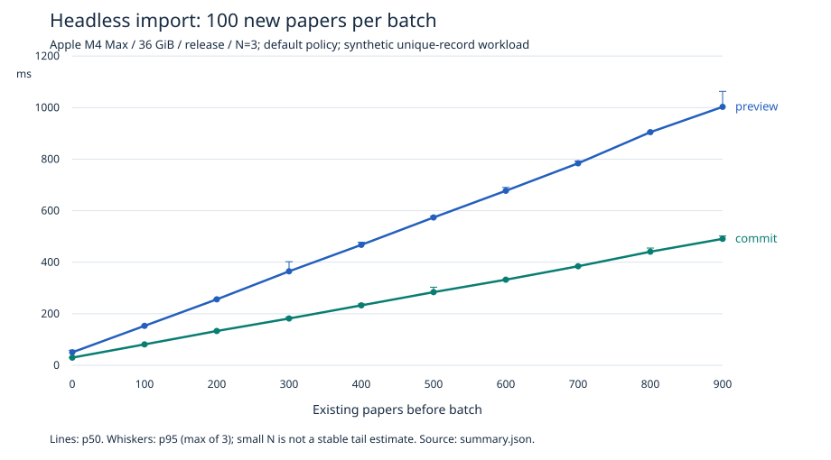

# #47 release headless backend baseline

Measured 2026-11-07 JST from benchmark implementation commit
`f273466d72c6baa240dc0870a6f47d104b6ac75f`, based on merged main
`fd50af1fe385c30b8581f06c90247630f27caf55` (#8/#12/#13/#33). Subsequent changes in this PR are evidence only.
The recorded working tree contains only untracked evidence files; measured harness
and Rust sources match that commit. The final CSV uses LF line endings.
No product optimization, schema/migration change, dependency/pin/lock change,
search DSL, PR #45 worker or GUI/native host operation is included. Independent
Opus review and CI/integration belong to the root agent; they are not local passes.

## Environment and reproduction

- Mac16,6, Apple M4 Max, 14 physical/logical CPU cores; arm64 macOS 27.2 (26B123).
- **36 GiB RAM (38,654,705,664 bytes)**; this differs from DESIGN §16's 16 GB target.
- Rust 1.99.1 (`58cf8f9c3`), Cargo 1.99.1, LLVM 23.1.1, bundled SQLite 3.54.1.
- Locked default-feature `--release`: opt-level 3, no debug assertions/debuginfo; no RUSTFLAGS/build-target override. Actual artifact profiles and SHA-256 are recorded.
- Seed 47; 10,000 query papers, 10 collections, 8 tags, 20,000 links in each membership table, 20,000 contributors and 20,000 external IDs. No PDF/attachment/fulltext/job data.
- Import: independently empty DB per repeat, 1,000 new synthetic BibTeX papers each, 10 explicit 100-row previews/commits per repeat, 3 repeats.
- Query: 21 samples per case/page/condition, 546 timed calls in total. Measurements ran sequentially without this agent running workspace checks concurrently. Other host/agent activity was not controlled.

```sh
python3 scripts/benchmarks/run.py --representative --out representative-release-lf
```

The [instrument/method](../../scripts/benchmarks/README.md) specifies fixture
formulas, private temporary storage, timing boundaries, decision policy and limits.
Outputs are retained under `target/backend-benchmark/representative-release-lf`; DBs
are deleted by their own TempDir owners. No user library was opened. Committed
[environment](BACKEND_BENCHMARK_2026-11-07/environment.json),
[raw query samples](BACKEND_BENCHMARK_2026-11-07/query.json),
[raw import samples](BACKEND_BENCHMARK_2026-11-07/import.json),
[summary JSON](BACKEND_BENCHMARK_2026-11-07/summary.json),
[summary CSV](BACKEND_BENCHMARK_2026-11-07/summary.csv), and
[synthetic per-batch log](BACKEND_BENCHMARK_2026-11-07/import.log) are inspectable.
Build logs stay in target; environment evidence retains actual executable profiles/hashes.

## Query correctness and timings

The fixture uses **direct SQL on its own fixture connection**, with foreign keys
ON, production WAL/FULL schema and one transaction. This is not CRUD/ImportService
filling speed. Generation/serialization/insert/checkpoint seed time was
**444.529 ms**, outside all query samples. Integrity check was `ok`,
foreign-key check returned 0 rows, exact counts and all membership contents passed.
The reopened production factory checked immutable migration history. Full traversal
checked exact ordered IDs, complete Paper metadata, cursor progress and terminal pages
in **391.086 ms**, also outside samples. SHA-256 of the ordered fixture Papers:
`0386c3881aadab6e8ed95e33c0d3a97b3541258d83a5fff12f3c462d92f704b4`.

| Case | Expected = actual hits | Validated pages (limit 50) |
|---|---:|---:|
| list | 10,000 | 200 |
| metadata_keyword | 1,429 | 29 |
| metadata_no_hit | 0 | 1 |
| collection | 2,000 | 40 |
| tag_all | 1,250 | 25 |
| tag_any | 3,750 | 75 |
| combined | 71 | 2 |

The table below reports **bounded API page calls**, not whole-result scans or GUI
latency. Page 0 is the first page; page 1 uses its real cursor. `Reopened` means
a fresh production connection per call; its separate open/history/baseline validation
duration is in raw `open_ms`/summary `connection_open`, excluded here. **OS caches
were not evicted** and validation already read the data. `Warm` uses one retained
connection and one untimed identical priming call. Conditions/order are fixed.
All times below are milliseconds; quantiles are nearest rank `ceil(p*N)-1`.
Each cell is p50 / p95 over 21 calls.

| Case | Page | Returned / call | Reopened p50 / p95 (ms) | Warm p50 / p95 (ms) |
|---|---:|---:|---:|---:|
| list | 0 | 50 | 0.723 / 0.803 | 0.739 / 0.792 |
| list | 1 | 50 | 0.845 / 0.916 | 0.866 / 0.951 |
| metadata_keyword | 0 | 50 | 2.794 / 2.994 | 2.121 / 2.447 |
| metadata_keyword | 1 | 50 | 2.383 / 2.500 | 2.053 / 2.278 |
| metadata_no_hit | 0 | 0 | 42.253 / 44.619 | 42.619 / 43.924 |
| collection | 0 | 50 | 0.815 / 0.919 | 0.763 / 0.821 |
| collection | 1 | 50 | 0.968 / 1.049 | 0.859 / 0.938 |
| tag_all | 0 | 50 | 1.150 / 1.271 | 0.981 / 1.089 |
| tag_all | 1 | 50 | 1.178 / 1.302 | 0.989 / 1.113 |
| tag_any | 0 | 50 | 0.999 / 1.245 | 0.929 / 1.028 |
| tag_any | 1 | 50 | 1.035 / 1.104 | 0.846 / 0.923 |
| combined | 0 | 50 | 27.792 / 28.737 | 27.743 / 27.925 |
| combined | 1 | 21 | 11.736 / 12.033 | 11.885 / 12.008 |

## Actual parser / confirmed import timings

Input is 1,091,560 synthetic UTF-8 BibTeX bytes, generated before timing; source SHA-256:
`22fe0a077c9ae8c2acc322fbab3f0087937dc932ce66645d908e8e73acf3f335`. Distinct SHA-derived titles deliberately avoid saturating
near-duplicate matching limits. This is a controlled unique-record workload, not
a natural-language duplicate-heavy library or a real researcher import distribution.
Each repeat begins with zero papers. Collection/tag setup is outside timing.
The real #13 parser feeds ten fresh #33 previews with default TTL/capacity/budgets.
The fixture explicitly inspects normalized rows and submits Create decisions for
valid unique DOI/key rows; no human/GUI/IPC authorization claim is made.
No retry, TTL relaxation, automatic merge or larger batch is used.

All **30 previews left DB and WAL byte-identical**. A second real production
connection observed each count progression 0→100→…→1000. All 30 commits created
exactly 100 rows with zero merge/skip; each independently reopened DB contained
1,000 fully equal bibliographies/external IDs and all expected collection/tag links.
Each preview/commit duration is retained in raw JSON/logs, including first/last batches.

`total_ms` runs from parser start through the final batch count check, including
hashes, readback, fixture decision construction and instrumentation. It excludes
source generation, DB setup, and final reopen/full-content verification (each is
recorded separately). It is not human approval waiting time.

| Repeat | Parser (ms) | Total wall (ms) | Reopened stored count |
|---|---:|---:|---:|
| 0 | 25.282 | 8127.403 | 1000 |
| 1 | 12.513 | 8270.927 | 1000 |
| 2 | 11.986 | 8284.156 | 1000 |

| Batch | Existing papers before | Preview p50 / p95 (ms) | Commit p50 / p95 (ms) | Created / commit |
|---|---:|---:|---:|---:|
| 1 | 0 | 50.348 / 58.501 | 29.773 / 29.797 | 100 |
| 2 | 100 | 153.086 / 153.732 | 81.173 / 81.769 | 100 |
| 3 | 200 | 255.963 / 257.441 | 133.139 / 133.184 | 100 |
| 4 | 300 | 364.695 / 402.002 | 181.632 / 186.604 | 100 |
| 5 | 400 | 467.340 / 477.430 | 232.595 / 237.881 | 100 |
| 6 | 500 | 573.633 / 579.210 | 283.926 / 303.005 | 100 |
| 7 | 600 | 677.279 / 690.192 | 332.235 / 333.192 | 100 |
| 8 | 700 | 783.825 / 793.104 | 384.385 / 384.469 | 100 |
| 9 | 800 | 904.671 / 906.188 | 440.838 / 454.921 | 100 |
| 10 | 900 | 1002.893 / 1062.966 | 490.752 / 501.878 | 100 |

Total p50 / p95: **8270.927 / 8284.156 ms** over three repeats.
With N=3, p95 is simply the largest observation; it is not a robust tail estimate
or confidence interval. Do not combine samples at different inventory sizes as
one latency distribution. The JSON/CSV includes per-batch decision durations too.



## Evidence-supported follow-up, deferred

The first/last preview medians are 50.348 / 1,002.893 ms; commit medians are
29.773 / 490.752 ms, while every batch still contains 100 rows. This is observed
under increasing inventory, not proof that all imports are fast/slow or that one
function is the bottleneck. Existing inventory materialization/revision and
pairwise duplicate classification are visible in the unchanged
`storage/src/repositories/import.rs` and `core/src/import/{service,dedup}.rs`.
A separate issue could profile these phases and investigate candidate lookup while
preserving DOI compatibility, full reviewed matches, stale/ABA checks, preview byte
budgets and atomic decisions. This PR proposes no algorithm/index change and
attributes no measured duration to a subphase that was not individually timed.

## Scope limits and handoff

These are synchronous headless API observations on a 36 GiB machine. They do not
complete DESIGN §16 or parent #30: no 16 GB whole-app load, GUI collection switch
latency, warm app startup, scrolling/frame p95, CPU/I/O/RSS (including headless RSS),
1,000 PDFs/20,000 pages, FTS/Japanese recall, jobs, crash recovery or security
regression was measured. No total PDF/process memory claim is made.
#15 GUI gate, #34 HELD, and #25/#23 closed gates remain intact.

Local checks completed on the measured implementation source (evidence-only files added afterward).
The [machine-readable check report](BACKEND_BENCHMARK_2026-11-07/checks.json) and its numbered logs record actual commands, exit codes, durations and hashes.
Independent different-model read-only review is pending root, and CI is separate.
No merge/watch/polling is performed by this implementation agent.

## Local validation

| Command | Result |
|---|---|
| `cargo fmt --all -- --check` | exit 0 |
| `cargo clippy --workspace --all-targets --locked -- -D warnings` | exit 0 |
| `cargo test --workspace --locked` | 159 passed, 0 failed, 0 ignored, 0 filtered out; 136.55 s including build |
| `cargo build --workspace --locked` | exit 0 |
| `python3 scripts/check_architecture.py` | exit 0 |
| `python3 scripts/check_migrations.py --base fd50af1fe385c30b8581f06c90247630f27caf55` | exit 0 |
| `python3 -m unittest discover -s scripts -p test_*.py -v` | 21 passed (including 3 instrument tests) |
| `git diff --check` | exit 0 |

The existing 1000-paper BibTeX and RIS real-SQLite roundtrip tests both passed
(their shared test binary took 124.57 seconds). The two new Rust small instrument
tests also ran in the workspace command. Representative 10k/1k runs remain opt-in;
normal CI gains only the small deterministic correctness tests. No native-feature
PDFium/GUI/signing lane is claimed as locally run.

Logs are synthetic-only. Excess final blank lines are removed in committed logs
for repository whitespace rules; checks.json preserves the raw hash when this occurs.
